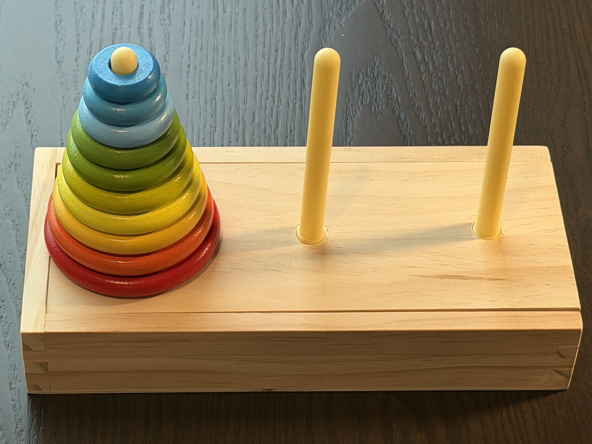

# The Towers of Hanoi

This repository holds the slides I developed for a [Project Mathtopia](https://sites.google.com/uwalumni.com/projectmathtopia/home) presentation.
You can find the live version of the site [here](https://deepsymmetry.org/hanoi/).
If you navigate to the page before the title page you land on, you will see instructions for how to use the keyboard to navigate the presentation, including opening a presenter notes window with notes about some slides, or steps within multi-step slides.

The file `bb.edn` at the top level is a configuration file for [babashka](https://babashka.org) that makes it easy to launch a local web server for development, including an [nREPL server](https://github.com/nrepl/nrepl) which supports live access to the code running in the pages from a Clojure development environment, by running `bb dev` in the project directory once you have installed babashka.

The rest of the repository is the content of the static site, which can be served by any web server.
The folder `resources/public` holds the HTML pages that make up the slides themselves, and there are subdirectories within that holding other resource types:

* `cljs/`: the [Clojurescript](https://clojurescript.org) code that provides the interactive elements of the slides, including the animations.
* `css/`: the cascading style sheets that style the slides.
* `images/`: photos or drawings used on some slides.
* `js/`: holds [Scittle](https://babashka.org/scittle/), which teaches the browser how to run scripts written in Clojurescript rather than Javascript.
* `partials/`: HTML fragments used to assemble pages, such as the navigation bar at the bottom of each slide, and the content of the presenter notes window for slides and/or steps which have notes.
